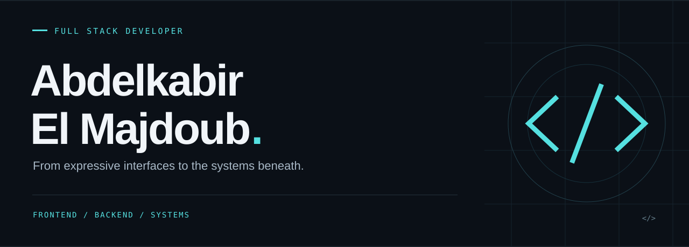

  
  &nbsp;
  

 

### 01 / About

I'm **Abdelkabir El Majdoub**, a full stack developer working across web interfaces, APIs, databases, and systems programming.

My toolkit connects **React** interfaces with **Express.js** backends and **PostgreSQL**, alongside **C, C++, and Docker**.

 

### 02 / Toolkit

**Frontend** &nbsp; / &nbsp; Interfaces & experiences

**Backend** &nbsp; / &nbsp; APIs & data

**Systems & deployment** &nbsp; / &nbsp; Under the hood

 

### 03 / Selected work

#### [Portfolio ↗](https://elmajdoub-portfolio.vercel.app/)
My personal space on the web. Explore my work and projects.

---

#### [minishell-42 ↗](https://github.com/abdelkabirelmajdoub/minishell-42)
[Explore the repository →](https://github.com/abdelkabirelmajdoub/minishell-42)

---

#### [webserv ↗](https://github.com/ourhouchmohamed97/webserv)
[Explore the repository →](https://github.com/ourhouchmohamed97/webserv)

 

### 04 / Languages

| Arabic | English | French |
| :--- | :--- | :--- |
| Native language | Very good proficiency | Basic proficiency |

 

---

  <strong>Interfaces. APIs. Systems.</strong>  
  <a href="https://elmajdoub-portfolio.vercel.app/">Visit my portfolio ↗</a>

